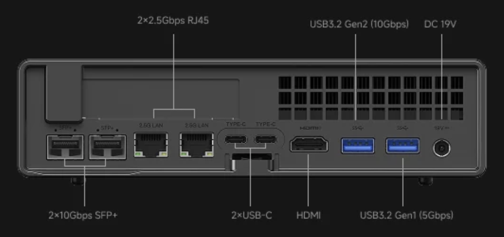
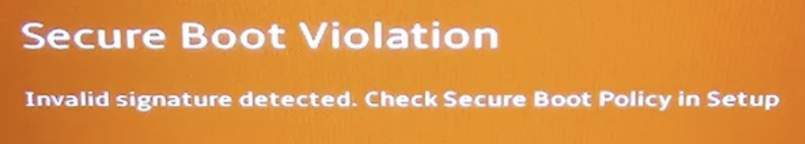

= Install on New Hardware

After multiple issues with the 2 used Dell PowerEdge R730xd servers.  I bought a bare bones https://store.minisforum.com/products/minisforum-ms-a2-workstation[Minisforum MS-A2] 8945HX and used the RAM and NVME from my GMKtec minipc to get it working.  I chose this based on the https://oxide.computer/blog/voxel-labs[post] from Steve Karam about Voxel.  Steve used a 9955HX with 96 GB RAM, but my setup should be enough for playing around and testing.  

The MS-A2 has 4 on-board network interfaces, 2 Intel 10G SFP ports, 1 Intel 2.5G RJ45 port, and 1 Realtek 2.5G RJ45 port.  I plan on using the Intel 2.5G port and on my device it is the RJ45 port beside the SFP port.  The Realtek port is the same chipset that didn't work from the GMKtek minipc. 

2.5Gb LAN(RJ45,Realtek RTL8125) х 1
2.5Gb LAN(RJ45,Intel I226-V) х 1
10G SFP+(Intel X710) x 2

Of course I ran into an issue with this device also.  After getting the hardware transferred, I inserted the boot USB, powered on the system, and got a bright red secure boot error screen.  

Using Ctrl-Alt-Del I restarted, spammed the ESC key and got into the BIOS where I found the option to disable the secure boot was grayed out.  I found multiple sources telling me to set the Admin password and that would allow me to disable it.  I set the password rebooted back to the setup and still found that I could not change the setting.  After some more searching I found a post that said I had to remove the boot USB to be able to change the setting.  After removing the drive and rebooting back into settings I was finally able to disable the setting.  Rebooting with the USB this time got me the install screen.  

