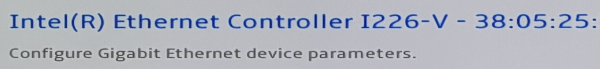
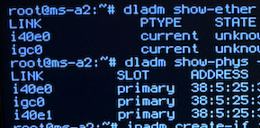
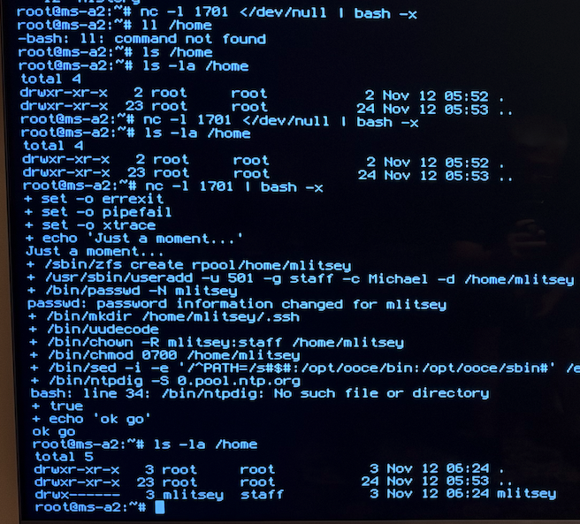
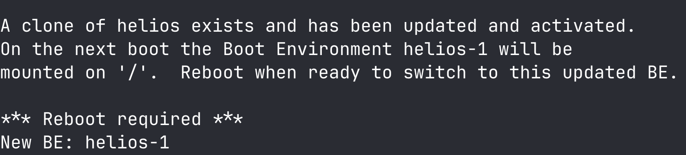

= Install on New Hardware

[#top]
:toc:
:toclevels: 1
:sectnums:
:icons: font
:source-highlighter: rouge 
:top-of-page: <<top, Top of Page>>   

After multiple issues with the 2 used Dell PowerEdge R730xd servers.  I bought a bare bones https://store.minisforum.com/products/minisforum-ms-a2-workstation[Minisforum MS-A2] 8945HX and used the RAM and NVME from my GMKtec minipc to get it working.  I chose this based on the https://oxide.computer/blog/voxel-labs[post] by https://www.linkedin.com/in/stevekaram/[Steve Karam] about Voxel.  Steve used a 9955HX with 96 GB RAM, but my setup should be enough for playing around and testing.  

The MS-A2 has 4 on-board network interfaces, 2 Intel 10G SFP ports, 1 Intel 2.5G RJ45 port, and 1 Realtek 2.5G RJ45 port.  I plan on using the Intel 2.5G port and on my device it is the RJ45 port beside the SFP port.  The Realtek port is the same chipset that didn't work from the GMKtek minipc. 

2.5Gb LAN(RJ45,Realtek RTL8125) х 1  
2.5Gb LAN(RJ45,Intel I226-V) х 1  
10G SFP+(Intel X710) x 2  

image::./assets/ms-a2_ports.png[]

== Initial Boot

Of course I ran into an issue with this device also.  After getting the hardware transferred, I inserted the boot USB, powered on the system, and got a bright red secure boot error screen.  

image::./assets/secure_boot.png[]

Using `Ctrl-Alt-Del` I restarted, spammed the `ESC` key and got into the BIOS where I found the option to disable the secure boot was grayed out.  I found multiple sources telling me to set the Admin password and that would allow me to disable it.  I set the password rebooted back to the setup and still found that I could not change the setting.  After some more searching I found a https://williamlam.com/2025/07/quick-tip-updating-firmware-on-minisforum-ms-a2.html[post] with a comment that said I had to remove the boot USB to be able to change the setting.  After removing the drive and rebooting back into settings I was finally able to disable the setting.  Rebooting with the USB this time got me the install screen.  

While in the BIOS I noticed that the Network screen showed the MAC address for each of the connections.  This was helpful when setting up the network after installation.  Here is an example with 3 of the 6 pairs shown.  

{top-of-page}

== Helios Install

Back on the Oxide install GitHub https://github.com/oxidecomputer/helios-engvm#initial-install[page] I started stepping through the guide.  

=== OS Install
[source,bash]
----
diskinfo

# Example: install-helios <hostname> <diskinfo number>
install-helios ms-a2 c1t0C82D5250700EXAMPLE

reboot
----

=== Network Setup

Using the MAC address info from the BIOS earlier, I was able to see that `igc0` was the correct device to setup.  

[source,bash]
----
# start history file
touch ~/.bash_history

dladm show-ether

dladm show-phys -m

ipadm create-if igc0

ipadm create-addr -T dhcp -h $(hostname) igc0/dhcp
----

I didn't have the ethernet cable plugged into the correct port and got a warning that `dhcpagent timed out`.  I moved the cable and continued with restarting the service. 

[source,bash]
----
svcadm restart network/service

ipadm show-addr

# Write commands to the ~/.bash_history file
history -a
----

{top-of-page}

=== User Setup

I haven't been able to use the commands from the guide directly for this.  I tried multiple times but end up having to remove the `</dev/null` portion of the command.  I pulled the repository and setup the ssh key in my previous attempts.  

[source,bash]
----
# Helios Server
nc -l 1701 </dev/null | bash -x

nc -l 1701 | bash -x

# Laptop
cd ~/Projects/helios-engvm

./aws/gen_userdata.sh | nc 192.168.35.214 1701

# Helios Server: Check that account has been created
ls -la /home

# Setup account for sudo permissions
visudo

# Set password for account
passwd mlitsey

# Laptop: Login to server
ssh -i ~/.ssh/oxide 192.168.35.214

# Test root access
sudo -i
----

{top-of-page}

=== System Setup

This time through I want to try to do everything as my user account.  To do this I'm using the `pfexec` command when needed and as a last restore `sudo -i` to become root for anything that `pfexec` didn't fix.  

Configuring multicast DNS worked as my account.  Moving on to configuring the swap/dump space I started to need more privileges.  

I could run the `zfs create` command using `pfexec` but couldn't add it to the `vfstab` until I became root.  

When I ran the system update `pfexec pkg update -v` I was told that pkg was out of date and to run `pfexec pkg install pkg:/package/pkg`.  I could then run the system update.  

{top-of-page}

== Omicron Install

Returning to the https://github.com/oxidecomputer/omicron/blob/main/docs/how-to-run.adoc#prerequisite-software[How to run] document for Omicron.  

=== Prerequisite Software

[source,bash]
----
# create mount point for scripts/programs to survive updates/reboots/shutdowns
pfexec zfs create -o mountpoint=/usr/local rpool/local

# check
zfs list

# create directories
pfexec mkdir -p /usr/local/bin

# create the script
vim /usr/local/bin/tmux-global-logging.sh

# set permissions: 
pfexec chmod 755 /usr/local/bin/tmux-global-logging.sh

# install tmux
sudo pkg install tmux htop

# start tmux session or attach to session called mlitsey
tmux new-session -A -s mlitsey

# Get the omicron repository
mkdir ~/Projects
cd ~/Projects
git clone https://github.com/oxidecomputer/omicron.git

cd omicron

source env.sh
./tools/install_prerequisites.sh 
----

You get asked a some questions about installation during this process.  I answered yes to all of them.  

=== Network

[source,bash]
----
cargo xtask virtual-hardware create \
   --gateway-ip 192.168.35.1 \
   --pxa-start 192.168.35.180 \
   --pxa-end 192.168.35.200
----

Later, you can clean up the resources created by cargo xtask virtual-hardware create with:

`cargo xtask virtual-hardware destroy`

=== Certificates

[source,bash]
----
# set variable for machine type
MACHINE="non-gimlet"

# verify it is set
echo $MACHINE

# check directory
ll ./smf/sled-agent/$MACHINE/

# create TLS certificates
cargo xtask cert-dev create ./smf/sled-agent/$MACHINE/initial-tls- '*.sys.oxide.test'
----

wrote certificate to ./smf/sled-agent/non-gimlet/initial-tls-cert.pem  

wrote private key to ./smf/sled-agent/non-gimlet/initial-tls-key.pem  

{top-of-page}

=== Rack Configuration

[source,bash]
----
vim smf/sled-agent/$MACHINE/config-rss.toml
----

[source,ini]
----
external_dns_ips = [ "192.168.35.181", "192.168.35.182" ]

[[service_ip_pools]]
name = "oxide-service-pool-v4"
description = "IPv4 IP Pool for Oxide Services"
ranges = [ { first = "192.168.35.180", last = "192.168.35.200" } ]

infra_ip_first = "192.168.35.192"
infra_ip_last = "192.168.35.192"

[[rack_network_config.ports]]
# Routes associated with this port.
routes = [{nexthop = "192.168.35.1", destination = "0.0.0.0/0"}]
# Addresses associated with this port.
addresses = [{address = {type = "static", ip_net = "192.168.35.180/24"}}]
# Name of the uplink port.  This should always be "qsfp0" when using softnpu.
port = "qsfp0"
# The speed of this port.
uplink_port_speed = "1G"
----

=== Package Install

Choosing defaults that made sense for my setup and testing. I ran the following commands. 
[source,bash]
----
# setup
cargo run --release --bin omicron-package -- target create --help

# Configure for non-gimlet hardware
cargo run --release --bin omicron-package -- -t default target create -p dev -m non-gimlet -r single-sled -c single-node

# Package install
cargo run --release --bin omicron-package -- package

pfexec ./target/release/omicron-package install
----

I'm closer to getting it working.  I was abel to see some services using `zoneadm list -cnv` but wasn't able to use `dig` to discover the IP's to use.  

{top-of-page}

=== Clean Up

I'm going to clean up and take another look at my configuration before deploying again.  

[source,bash]
----
# To uninstall all Omicron services from a machine:

cargo build --release --bin omicron-package
pfexec ./target/release/omicron-package uninstall

# Once all the Omicron services are uninstalled, you can also remove the previously created virtual hardware as mentioned above:

cargo xtask virtual-hardware destroy
----

{top-of-page}
