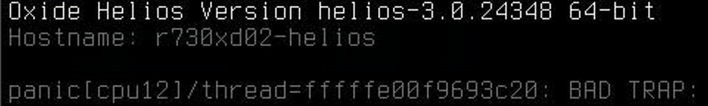

= Installing Oxide Control Plane
[[top]]
:toc:
:toclevels: 1
:sectnums:
:icons: font
:source-highlighter: rouge 
:top-of-page: <<top, Top of Page>>   

link:./README.md[Front Page Link]  

== Intro

I'll be using the setup demonstrated by https://matthewsanabria.com/[Matthew Sanabria] on https://youtu.be/qwXtS0-r1uQ?si=B8dbVxtm1Kt5Qcmf[YouTube] to do my initial setup.  

Documentation can be found in the https://github.com/oxidecomputer/omicron/blob/main/docs/how-to-run.adoc#prerequisites[how-to-run.adoc] document on GitHub.  

== Install prerequisites

I want to log what I'm doing on the server and have choosen to use `tmux` to maintain my session between disconnects.  You can find tmux commands https://tmuxcheatsheet.com/[here].  I also use link:./tmux-global-logging.sh[this script] to perform logging while using tmux.  You could also use the `script` command if you don't want to install tmux.  

Download the Omicron repository to the Helios server.  

[source,bash]
----
# create mount point for scripts/programs to survive updates/reboots/shutdowns
pfexec zfs create -o mountpoint=/usr/local rpool/local

# check
zfs list

# create directories
pfexec mkdir -p /usr/local/bin

# create the script
vim /usr/local/bin/tmux-global-logging.sh

# set permissions: 
pfexec chmod 755 /usr/local/bin/tmux-global-logging.sh

# install tmux
sudo pkg install tmux htop

# start tmux session or attach to session called mlitsey
tmux new-session -A -s mlitsey

# Get the omicron repository
mkdir ~/Projects
cd ~/Projects
git clone https://github.com/oxidecomputer/omicron.git
----

Now I have a directory called `omicron` in my Projects directory.  

=== Networking

I have a lot of open addresses on my VLAN and am choosing not to setup the "external" https://github.com/oxidecomputer/omicron/blob/main/docs/how-to-run.adoc#external-networking[network].  

=== Machine Type

`non-gimlet` since I'm not using real Oxide equipment.  

=== Prerequisite software

[source,bash]
----
cd ~/Projetcs/omicron
source env.sh
./tools/install_prerequisites.sh 
----

I ran into an issue with the `cargo` path.  I installed it as root and my user account couldn't find it.  

[source,bash]
----
./tools/install_builder_prerequisites.sh: line 97: cargo: command not found
Failed to run command -- will try 2 more times
./tools/install_builder_prerequisites.sh: line 97: cargo: command not found
Failed to run command -- will try 1 more times
./tools/install_builder_prerequisites.sh: line 97: cargo: command not found

# check for cargo
mlitsey@r730xd01-helios:~ $ which cargo
no cargo in $PATH

mlitsey@r730xd01-helios:~ $ sudo -i
The illumos Project     helios-3.0.23976        May 2026
You have new mail.

root@r730xd01-helios:~ # which cargo
/root/.cargo/bin/cargo
----

I'll switch over to the root account and run the commands again.  

{top-of-page}

== Build and deploy Omicron

Reminder that the documentation is located https://github.com/oxidecomputer/omicron/blob/main/docs/how-to-run.adoc#build-and-deploy-omicron[here].  

.Click to show code
[%collapsible]
====
[source,bash]
----
##### DO NOT USE -- vdev-dir DOES NOT WORK #####

cargo xtask virtual-hardware create \
   --vdev-dir /scratch_vdev \
   --gateway-ip 192.168.35.1 \
   --pxa-start 192.168.35.180 \
   --pxa-end 192.168.35.200

Finished `dev` profile [unoptimized + debuginfo] target(s) in 1.68s
     Running `target/debug/xtask virtual-hardware create --vdev-dir /scratch_vdev --gateway-ip 192.168.35.1 --pxa-start 192.168.35.180 --pxa-end 192.168.35.200
`
error: unexpected argument '--vdev-dir' found

  tip: a similar argument exists: '--vdev-size'

Usage: cargo xtask virtual-hardware create --vdev-size <VDEV_SIZE>

For more information, try '--help'.

root@r730xd01-helios:/home/mlitsey/Projects/omicron # cargo xtask virtual-hardware create --help
----
====

Error using the `--vdev-dir` option and it isn't in the help documentation.  It must have been removed at some point.  

.Toggle
[%collapsible%open]
====
[source,bash]
----
cargo xtask virtual-hardware create \
   --gateway-ip 192.168.35.1 \
   --pxa-start 192.168.35.180 \
   --pxa-end 192.168.35.200

    Finished `dev` profile [unoptimized + debuginfo] target(s) in 1.56s
     Running `target/debug/xtask virtual-hardware create --gateway-ip 192.168.35.1 --pxa-start 192.168.35.180 --pxa-end 192.168.35.200`
creating virtual hardware
creating /var/tmp/m2_0.vdev
creating /var/tmp/m2_1.vdev
creating /var/tmp/u2_0.vdev
creating /var/tmp/u2_1.vdev
creating /var/tmp/u2_2.vdev
creating /var/tmp/u2_3.vdev
creating /var/tmp/u2_4.vdev
creating /var/tmp/u2_5.vdev
creating /var/tmp/u2_6.vdev
creating /var/tmp/u2_7.vdev
creating /var/tmp/u2_8.vdev
Simnet net0/sc0_0 exists
Simnet net1/sc1_0 exists
Vnic sc0_1 exists
Using 192.168.35.1 as gateway ip
Pinging 192.168.35.1 and sleeping (0 / 3)
Pinging 192.168.35.1 and sleeping (1 / 3)
Pinging 192.168.35.1 and sleeping (2 / 3)
Pinging 192.168.35.1 and sleeping (3 / 3)
using <hidden> as gateway mac
configuring SoftNPU ARP entry
configuring SoftNPU proxy ARP
SoftNPU state:
  local v6:
  local v4:
  router v6_idx:
  router v6_routes:
  router v4_idx:
  router v4_routes:
  resolver v4:
  192.168.35.1 -> <hidden>
  resolver v6:
  nat v4:
  nat_v6:
  attached subnet v4:
  attached subnet v6:
  port_mac:
  proxy arp:
  192.168.35.180/192.168.35.200: <hidden>
created virtual hardware
----
====

=== Setup Config

.Toggle
[%collapsible%open]
====
[source,bash]
----
# set variable for machine type
root@r730xd01-helios:/home/mlitsey/Projects/omicron # MACHINE="non-gimlet"

# verify it is set
root@r730xd01-helios:/home/mlitsey/Projects/omicron # echo $MACHINE
non-gimlet

# check directory
root@r730xd01-helios:/home/mlitsey/Projects/omicron # ll ./smf/sled-agent/$MACHINE/

# create TLS certificates
root@r730xd01-helios:/home/mlitsey/Projects/omicron # cargo xtask cert-dev create ./smf/sled-agent/$MACHINE/initial-tls- '*.sys.oxide.test'

    Finished `dev` profile [unoptimized + debuginfo] target(s) in 2.12s
     Running `target/debug/xtask cert-dev create ./smf/sled-agent/non-gimlet/initial-tls- '*.sys.oxide.test'`
   Compiling usdt-macro v0.5.0
   Compiling usdt-attr-macro v0.5.0
   Compiling memmap v0.7.0
   Compiling yasna v0.5.2
   Compiling pem v3.0.6
   Compiling rcgen v0.12.1
   Compiling usdt v0.5.0
   Compiling tokio-dtrace v0.1.1
   Compiling oxide-tokio-rt v0.1.4
   Compiling cert-dev v0.1.0 (/home/mlitsey/Projects/omicron/dev-tools/cert-dev)
    Finished `dev` profile [unoptimized + debuginfo] target(s) in 11.30s
     Running `target/debug/cert-dev create ./smf/sled-agent/non-gimlet/initial-tls- '*.sys.oxide.test'`
wrote certificate to ./smf/sled-agent/non-gimlet/initial-tls-cert.pem
wrote private key to ./smf/sled-agent/non-gimlet/initial-tls-key.pem
----
====

There is going to be a lot to setup in the https://github.com/oxidecomputer/omicron/blob/main/docs/how-to-run.adoc#rack-setup-configuration[configuration files]. 

Here is what is configured by default.

.Toggle
[%collapsible]
====
[source,bash]
----
cat ~/Projects/omicron/smf/sled-agent/$MACHINE/config-rss.toml |grep -vE "^#"

bootstrap_discovery.type = "only_ours"

ntp_servers = [ "0.pool.ntp.org" ]
dns_servers = [ "1.1.1.1", "9.9.9.9" ]

external_dns_zone_name = "oxide.test"

external_dns_ips = [ "192.168.1.20", "192.168.1.21" ]

external_certificates = []

[[service_ip_pools]]
name = "oxide-service-pool-v4"
description = "IPv4 IP Pool for Oxide Services"
ranges = [ { first = "192.168.1.20", last = "192.168.1.29" } ]

[rack_network_config]
rack_subnet = "fd00:1122:3344:0100::/56"

infra_ip_first = "192.168.1.30"
infra_ip_last = "192.168.1.30"

bgp = []

[[rack_network_config.ports]]
routes = [{nexthop = "192.168.1.199", destination = "0.0.0.0/0"}]
addresses = [{address = {type = "static", ip_net = "192.168.1.30/24"}}]
port = "qsfp0"
uplink_port_speed = "40G"
uplink_port_fec = "none"
autoneg = false
switch = "switch0"
bgp_peers = []

[allowed_source_ips]
allow = "any"

external_jumbo_frames_opt_in_enabled = false

[recovery_silo]
silo_name = "recovery"
user_name = "recovery"
user_password_hash = "<hash info here>"
----
====

**ON HOLD UNTIL SEVER IS FIXED OR REPLACED**

2026-10-23 update: server is giving intermittent CPU panic

  

2026-11-05 update: got another used Dell R730xd to test with.  

I setup my configuration `./smf/sled-agent/$MACHINE/config-rss.toml` for network communications then proceeded with the rest of the install. 

Choosing defaults that made sense for my setup and testing. I ran the following commands. 
[source,bash]
----
# setup
cargo run --release --bin omicron-package -- target create --help

# Configure for non-gimlet hardware
cargo run --release --bin omicron-package -- -t default target create -p dev -m non-gimlet -r single-sled -c single-node

# Package install
cargo run --release --bin omicron-package -- package

----

Ran into a problem downloading one of the files
[source,bash]
----
Error: Digest mismatch on pumpkind-gz: Saw 6f9113b819adfd9de80ac30ea2044c39573cfed5414e4554440ea8d49c0a6375, expected b7b356d7fce91de1f71948741ee92e673d26731327716bf645909e0515367f21

Caused by:
    Failed validating download of https://buildomat.eng.oxide.computer/public/file/oxidecomputer/pumpkind/image/a9564ed157edcc34ee1edfad7287660db398a6c7/pumpkind-gz.tar
----

At this point I ran `git pull` to get the latest updates, checked my configuration file to verify it still had my settings and ran the `cargo` commands again. 

At the install I ran into a version mismatch.

[source,bash]
----
pfexec ./target/release/omicron-package install

Logging to: /home/mlitsey/Projects/omicron/out/LOG

Error: Failure interacting with the OPTE ioctl(2) interface: command ListPorts failed: BadApiVersion { user: 44, kernel: 42 }

Caused by:
    command ListPorts failed: BadApiVersion { user: 44, kernel: 42 }
----

I tried updating Helios and did a reboot but ran into the same error. 

